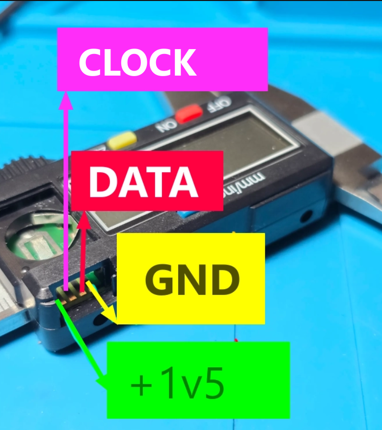

# GUIDE-002: Donanım Bağlantısı

**Hedef kitle:** Cihazı monte edecek kurulumcu  
**Gerekli beceri:** Temel lehimleme, multimetre kullanımı  
**İlgili:** [ADR-001](../adr/ADR-001_DONANIM_PLATFORMU_ESP32_S3_SUPER_MINI.md), [ADR-017](../adr/ADR-017_BATARYA_OLCUMU_VE_SARJ_CIKARIMI.md), [ADR-018](../adr/ADR-018_BUTON_GIRISI_VE_DEBOUNCE.md), [KS-05](../BILINEN_SORUNLAR.md#ks-05--buton-bağlantısı-ile-kod-mantığı-uyumsuz-), [KS-23](../BILINEN_SORUNLAR.md#ks-23--seviye-dönüştürme-için-pull-up-önerisi-riskli-olabilir-)

---

## 1. Malzeme Listesi

### Zorunlu

| Parça | Adet | Not |
|---|---|---|
| ESP32-S3 Super Mini (4 MB) | 1 | |
| DATA/CLOCK çıkışlı 24-bit dijital kumpas | 1 | Pil yuvası yanında 4 pinli konektörü olan modeller |
| Seviye dönüştürme devresi | 1 | §4'teki yöntemlerden biri |
| İnce çok damarlı kablo | ~30 cm | 4 damar (GND, DATA, CLK, opsiyonel Vcc) |
| USB-C veri kablosu | 1 | |

### İsteğe Bağlı

| Parça | Adet | Amaç |
|---|---|---|
| 1S LiPo batarya + şarj modülü (ör. TP4056) | 1 | Taşınabilir kullanım |
| 100 kΩ direnç | 2 | Batarya gerilim bölücü |
| 100 nF seramik kondansatör | 1 | ADC girişini kararlı kılmak |
| Anlık buton veya ayak pedalı | 1 | Ölçüm kaydı |
| Logic analyzer (8 kanal, 24 MHz klon yeterli) | 1 | Kumpas sinyalini doğrulamak, yeni model uyarlamak |

## 2. Pin Tablosu

| ESP32-S3 pini | Bağlantı | Yön | Yazılım ayarı |
|---|---|---|---|
| GPIO8 | Kumpas DATA (seviye dönüştürülmüş) | Giriş | `CALIPER_DATA_PIN` |
| GPIO9 | Kumpas CLOCK (seviye dönüştürülmüş) | Giriş, düşen kenar kesmesi | `CALIPER_CLK_PIN` |
| GPIO10 | Buton | Giriş, `INPUT_PULLUP` | `BUTTON_PIN` |
| GPIO5 | Batarya bölücü orta noktası | Analog (ADC1) | `BATTERY_ADC_PIN` |
| GND | Kumpas GND, bölücü alt ucu, buton (seçeneğe göre) | — | — |
| 3V3 | Seviye dönüştürücü yüksek taraf, buton (seçeneğe göre) | Çıkış | — |
| 5V / BAT | Batarya/şarj modülü çıkışı | Giriş | Kart modeline göre |

Pin değiştirmek için [src/main.cpp:9-12](../../src/main.cpp#L9-L12) sabitlerini düzenleyin. Batarya pini mutlaka **ADC1** kanalı (GPIO1–GPIO10) olmalıdır.

## 3. Kumpas Konektörü

Konektör genellikle pil kapağının yanında, bazen bir plastik kapağın altındadır. Tipik dizilim (modelden modele değişir):

```
┌──────────────────────────────┐
│   GND   DATA   CLK   Vcc(1,5V) │
└──────────────────────────────┘
```

**Pinleri doğrulama:**

1. Kumpası açın. Multimetreyi gerilim modunda kullanın.
2. Pilin bir ucuna (genellikle **eksi**, bazı modellerde **artı**) devamlılık gösteren pin referans (GND) pinidir. Hangisinin referans olduğunu multimetre ile kesinleştirin.
3. Referans ile diğer pinler arasında ölçün: ~1,5 V sabit olan Vcc'dir.
4. Kalan iki pin DATA ve CLOCK'tur. Logic analyzer ile bakıldığında CLOCK düzenli darbe patlamaları, DATA ise değişken bir desen gösterir. Logic analyzer yoksa iki olasılığı da deneyin (yanlış sırada hiç geçerli ölçüm gelmez, donanıma zarar vermez).



## 4. Seviye Dönüştürme

Kumpas sinyalleri ~1,5 V'tur. ESP32-S3'ün güvenilir "1" eşiği (VIH) yaklaşık 0,75 × 3,3 V ≈ 2,5 V'tur. Doğrudan bağlantıda "1" seviyesi eşiğin altında kalır; okuma ya hiç olmaz ya da kararsız olur. **Toprak her zaman ortak olmalıdır.**

### Yöntem A — NPN transistörlü evirici (önerilen, en ucuz)

Her hat için bir NPN (BC547, 2N3904, MMBT3904):

```
Kumpas DATA ──[ 10–47 kΩ ]──► B  (NPN)
                               E ──► GND
3V3 ──[ 10 kΩ ]──┬───────────► C
                 └──────────────────► ESP32 GPIO8
(CLOCK için aynısı → GPIO9)
```

Bu devre sinyali **ters çevirir**. Yazılımda iki değişiklik gerekir ([src/main.cpp](../../src/main.cpp)):

```cpp
// caliperBegin():  düşen kenar yerine yükselen kenar
attachInterrupt(clkPin, onCaliperClockFalling, RISING);

// onCaliperClockFalling():  okunan biti ters çevir
const uint32_t bit = ((uint32_t)gpio_get_level((gpio_num_t)g_dataPin) & 0x1u) ^ 0x1u;
```

### Yöntem B — Karşılaştırıcı (en temiz kenarlar)

LM393/LMV393 gibi bir karşılaştırıcı, eşik ~0,75 V (bölücüyle 1,5 V'un yarısı), açık-kollektör çıkış 10 kΩ ile 3,3 V'a çekili. Giriş uçları uygun bağlanırsa sinyal ters çevrilmez; yazılım değişikliği gerekmez.

### Yöntem C — Hazır seviye dönüştürücü modülü

BSS138 tabanlı çift yönlü modüller düşük tarafta en az ~1,8 V ister; 1,5 V'ta MOSFET tam iletime geçmeyebilir. Kullanmadan önce logic analyzer ile ESP32 tarafındaki sinyali doğrulayın. Tek yönlü, düşük gerilimli girişli modüller (ör. 74LVC1T45 tabanlı, 1,2–3,6 V) daha uygundur.

### Yöntem D — Doğrudan pull-up (README'deki "en basit çözüm") ⚠️

DATA ve CLOCK'u 10 kΩ ile 3,3 V'a çekmek yalnızca kumpas çıkışları **açık-drenaj** ise çalışır. Çıkış itme-çekme ise kumpasın 1,5 V hattına akım enjekte edilir; kumpas bozulabilir veya ekran tuhaflaşabilir. Kumpasınızın çıkış tipini bilmiyorsanız bu yöntemi kullanmayın (KS-23).

## 5. Buton

> ⚠️ Mevcut kod ile README'deki bağlantı uyumsuzdur (KS-05). Aşağıdakilerden birini seçin.

| Seçenek | Bağlantı | Kod değişikliği | Durum |
|---|---|---|---|
| **A (önerilen)** | GPIO10 ─ buton ─ GND | `pressed = (digitalRead == LOW)`, başlangıç değerleri `false` ([ADR-018](../adr/ADR-018_BUTON_GIRISI_VE_DEBOUNCE.md)) | Düzeltme gerekir |
| B | GPIO10 ─ buton ─ 3V3 | `pinMode(BUTTON_PIN, INPUT_PULLDOWN)` | Düzeltme gerekir |
| C | TTP223 dokunmatik modül OUT → GPIO10 (VCC 3V3, GND) | Yok — mevcut kodla çalışır | Hemen çalışır |

**Değişiklik yapmadan "buton → GND" bağlarsanız:** kayıt basma anında değil bırakma anında oluşur ve boşta `btn=pressed` görünür.

Ayak pedalı kullanılacaksa kablo uzunluğu 1 m'yi aşıyorsa GPIO10–GND arasına 100 nF eklemek gürültüyü azaltır.

## 6. Batarya Ölçümü

```
LiPo (+) ──┬── [ R1 = 100 kΩ ] ──┬── [ R2 = 100 kΩ ] ── GND
           │                     │
           │                     ├── GPIO5
           │                     └── [ 100 nF ] ── GND   (önerilir)
           └── Şarj modülü / kart beslemesi
```

- Bölücü oranı 2,0 → 4,2 V batarya = 2,1 V ADC. ADC 11 dB zayıflatmada ~3,1 V'a kadar ölçer.
- Bölücü sürekli ~21 µA çeker.
- Farklı dirençler kullanırsanız `BAT_R1_OHMS` / `BAT_R2_OHMS` değerlerini güncelleyin ([GUIDE-011](GUIDE-011_BATARYA_OLCUMU_AYARI.md)).
- Batarya kullanmıyorsanız GPIO5'i boş bırakabilirsiniz; arayüzde anlamsız yüzde görünür.

## 7. Kumpasın Beslenmesi

- **Önerilen:** Kumpas kendi pilini (LR44/SR44) kullanmaya devam etsin; yalnızca GND ortaklansın.
- Kumpası ESP32'den beslemek isterseniz 1,5 V çıkışlı düşük akımlı bir regülatör kullanın (kumpas tipik olarak onlarca µA çeker). 3,3 V'u doğrudan kumpasa vermeyin.

## 8. Montaj Sonrası Kontrol Listesi

- [ ] Kumpas GND ↔ ESP32 GND devamlılık var
- [ ] ESP32 3V3 ↔ GND arasında kısa devre yok
- [ ] Seviye dönüştürücü çıkışında logic analyzer ile 0 V / 3,3 V darbeler görülüyor
- [ ] Kumpas ekranı bağlantıdan önceki gibi normal çalışıyor
- [ ] Batarya bağlıyken GPIO5'te (LiPo gerilimi / 2) ölçülüyor
- [ ] Butona basınca GPIO10 seviyesi değişiyor (seçtiğiniz seçeneğe uygun yönde)

Ardından: [GUIDE-003](GUIDE-003_DERLEME_YUKLEME_VE_SERI_MONITOR.md) ile yükleyin ve [GUIDE-015](GUIDE-015_TEST_VE_DOGRULAMA.md) TC-01…TC-05 testlerini çalıştırın.
